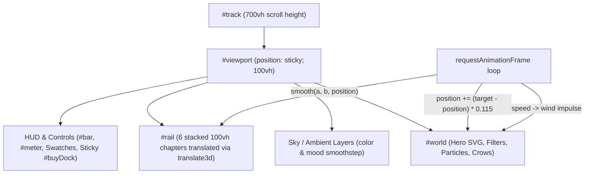

# 👁️ Cinematic Scroll Web Skill (`cinematic-scroll-web`)

[](./LICENSE)
[-11131a.svg)](#)
[](#architecture)
[](#installation)

> **Build 60fps continuous scroll-coupled interactive web experiences** — from cinematic manga storytelling (*Uchiha Itachi — The Red Sharingan*) to high-converting e-commerce product launches (*exploded macro views, live colorway switchers, sticky checkout docks*) using **zero external libraries**.

*(Cuộn trang để kể chuyện điện ảnh & bán hàng cao cấp — chỉ với 1 file HTML/CSS/SVG thuần, mượt 60fps.)*

---

## ✨ Live Demos (GitHub Pages Ready)

Open the root [`index.html`](./index.html) via GitHub Pages or any local static server (`python -m http.server 8080`) to browse all 4 demos:

| Demo | Type | Key Techniques | Source |
| :--- | :--- | :--- | :--- |
| **Itachi — The Red Sharingan** | Interactive Manga | Pale moon → 3-Tomoe Sharingan → Mangekyō morph, Bézier flowing hair, crows scatter, blood tear | [`demos/itachi-sharingan/`](./demos/itachi-sharingan/index.html) |
| **KRONOS ZERO-1** | E-Commerce Launch | 4-layer exploded watch core, macro zoom, live colorway swatches, sticky Buy Dock + toast | [`demos/kronos-ecommerce/`](./demos/kronos-ecommerce/index.html) |
| **THE RED SUN (v3)** | Editorial Storytelling | Reactive SVG fog displacement, cloth/hem wind physics, continuous 6-chapter rail | [`demos/red-sun/`](./demos/red-sun/index.html) |
| **Starter Template** | Clean Scaffold | Minimal 6-stage scroll engine ready for new projects | [`demos/starter/`](./demos/starter/index.html) |

---

## 🧠 Architecture (`#track` → Sticky `#viewport` → `#world` + `#rail`)



- **Single Normalized Coordinate (`0.00 → 1.00`)**: Every layer—camera zoom, SVG rotation, exploded hardware parts, fog displacement, and copy transitions—is driven by `position` and `wind` inside one `requestAnimationFrame` loop.
- **No Discrete Slide Jumps**: Chapters move along a continuous `#rail` (`translate3d(0, -position * 5 * innerHeight, 0)`) paired with overlapping `smooth(a, b, position)` fades.

---

## 📦 Repository Structure

```text
.
├── index.html                                    # GitHub Pages showcase gallery
├── README.md
├── LICENSE
├── .gitignore
├── demos/
│   ├── itachi-sharingan/index.html               # Uchiha Itachi Sharingan showcase
│   ├── kronos-ecommerce/index.html               # Luxury watch e-commerce demo
│   ├── red-sun/index.html                        # Original Red Sun v3 experience
│   └── starter/index.html                        # Minimal starter scaffold
├── skills/
│   └── cinematic-scroll-web/                     # Standard skill-repo path
└── cinematic-scroll-web/                         # Portable skill package
    ├── SKILL.md                                  # Core workflow & SVG/CSS guardrails
    ├── references/
    │   ├── physics-and-svg-engine.md             # Spring-lerp math, filters, Bézier waves
    │   └── ecommerce-adaptation-guide.md         # 6-stage sales funnel & Buy Dock patterns
    └── examples/
        ├── starter-template.html
        └── ecommerce-product-showcase.html
```

---

## 🚀 Installation (Use in Any Project or Globally)

### Option A — Global Install (Works Across All Projects on Your Machine)

**Windows (PowerShell):**
```powershell
git clone https://github.com/TuanAnhPhan-pika/cinematic-scroll-skill.git "$env:TEMP\cinematic-scroll-skill"
New-Item -ItemType Directory -Force -Path "$HOME\.gemini\config\skills" | Out-Null
Copy-Item -Recurse -Force "$env:TEMP\cinematic-scroll-skill\skills\cinematic-scroll-web" "$HOME\.gemini\config\skills\"
Remove-Item -Recurse -Force "$env:TEMP\cinematic-scroll-skill"
```

**macOS / Linux (Bash):**
```bash
git clone https://github.com/TuanAnhPhan-pika/cinematic-scroll-skill.git /tmp/cinematic-scroll-skill \
  && mkdir -p ~/.gemini/config/skills \
  && cp -r /tmp/cinematic-scroll-skill/skills/cinematic-scroll-web ~/.gemini/config/skills/ \
  && rm -rf /tmp/cinematic-scroll-skill
```

### Option B — Workspace Install (Per-Project `.agents/skills/`)

**Windows (PowerShell):**
```powershell
New-Item -ItemType Directory -Force -Path ".agents\skills" | Out-Null
git clone https://github.com/TuanAnhPhan-pika/cinematic-scroll-skill.git "$env:TEMP\cinematic-scroll-skill"
Copy-Item -Recurse -Force "$env:TEMP\cinematic-scroll-skill\skills\cinematic-scroll-web" ".agents\skills\"
Remove-Item -Recurse -Force "$env:TEMP\cinematic-scroll-skill"
```

**macOS / Linux (Bash):**
```bash
mkdir -p .agents/skills \
  && git clone https://github.com/TuanAnhPhan-pika/cinematic-scroll-skill.git /tmp/cinematic-scroll-skill \
  && cp -r /tmp/cinematic-scroll-skill/skills/cinematic-scroll-web .agents/skills/ \
  && rm -rf /tmp/cinematic-scroll-skill
```

---

## 💬 Prompt Examples (E-Commerce & Storytelling)

- **E-Commerce Product Launch (Vietnamese):**
  > *"Dùng skill `cinematic-scroll-web` để làm landing page bán đồng hồ / tai nghe / nước hoa cao cấp: cuộn 6 giai đoạn, tách lớp cấu tạo SVG, zoom cận cảnh chi tiết, đổi màu trực tiếp và thanh mua hàng cố định ở dưới."*
- **Interactive Storytelling / Brand Story:**
  > *"Use the `cinematic-scroll-web` skill to build a 6-chapter continuous scroll brand story with reactive SVG atmosphere, smooth Bézier motion, and a final reveal CTA."*

---

## 🛡️ 6 Critical SVG & CSS Rules Built Into This Skill

1. **Never mix CSS `#id { opacity: 0 }` with SVG `setAttribute('opacity', ...)`** — CSS ID specificity overrides SVG presentation attributes.
2. **Wrap SVG `transform` pivots explicitly** — `transform-origin` in CSS does not apply to SVG `setAttribute('transform', ...)`; wrap with `translate(cx cy) ... translate(-cx -cy)`.
3. **Animate organic curves via cubic Bézier control points (`C`)** — avoid straight-line `L` spikes and heavy `skewX` distortions on hair, ribbons, or fabric.
4. **Lock hero wrappers to SVG `viewBox` `aspect-ratio`** — keeps zoom `transform-origin` dead-center on both desktop and mobile.
5. **Avoid flat horizontal SVG fog cutoffs** — use `stroke: none` and close cloud paths organically or below the viewport.
6. **Protect display-title contrast** — use multi-stop dark `text-shadow` and translucent `backdrop-filter` caption cards over bright focal elements.

---

## 🇻🇳 Hướng dẫn nhanh (Tiếng Việt)

1. Mở repo trên GitHub → bật **Settings → Pages → Deploy from a branch (`main` / `/root`)** để có ngay trang gallery demo online tại `index.html`.
2. Cài vào máy toàn cục (`~/.gemini/config/skills/cinematic-scroll-web`) hoặc từng dự án (`.agents/skills/cinematic-scroll-web`) bằng lệnh ở trên.
3. Trong bất kỳ project nào, nhắn Agent kích hoạt `cinematic-scroll-web` kèm mô tả sản phẩm hoặc câu chuyện bạn muốn làm.

---

## 📄 License

MIT © 2026 — Free to use, remix, and ship in personal and commercial projects.
